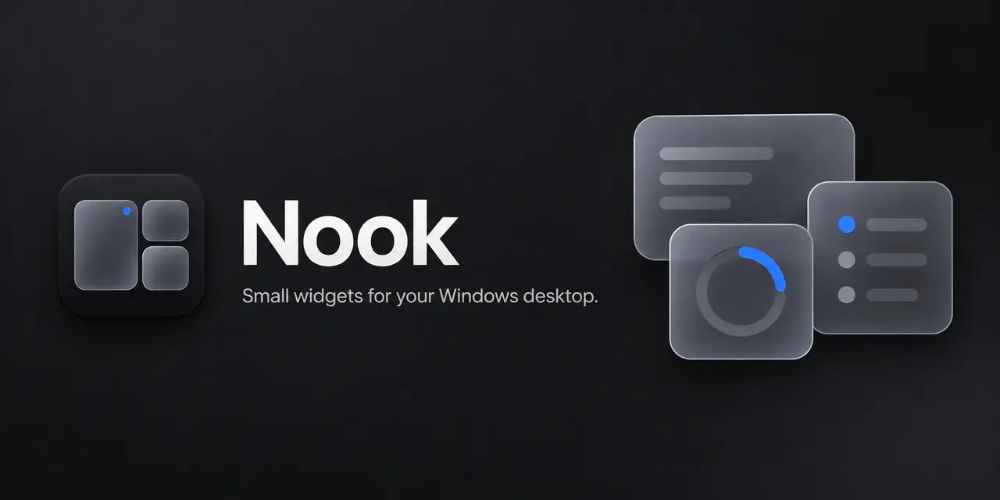

<p align="center">
  
</p>

<p align="center">
  <a href="https://github.com/hasanify/nook/releases"></a>
  <a href="https://github.com/hasanify/nook/actions/workflows/release.yml"></a>
  <a href="https://hasanify.github.io/nook/"></a>
  
  
  <a href="https://github.com/hasanify/nook/blob/main/LICENSE"></a>
</p>

# Nook

**Nook** is a lightweight, zero-configuration Windows-only desktop widget application built with Tauri v2, Rust, and React 19. Compact, borderless desktop widgets (productivity tools, developer utilities, system monitors, media playback, and AI reflection assistants) sit directly on the desktop layer below standard application windows and survive `Win+D` ("Show Desktop") and "Hide desktop icons".

---

## Features

- **Tray-Only Presence:** Runs exclusively from the notification tray. Never displays in the taskbar or Alt+Tab switcher for any window (including Settings). Closing Settings keeps Nook running.
- **Desktop Attachment (`PinStrategy::AboveIcons`):** Pinned directly into the desktop hierarchy above icons (`SHELLDLL_DefView`), surviving `Win+D` without losing keyboard focus.
- **Per-Widget Always on Top (`PinStrategy::Topmost`):** Any widget can be detached to stay above all normal application windows via right-click or settings.
- **Zero-Lag & Low Footprint:** Single shared Rust background HTTP poller with ETag caching and rate-limit backoff; near-zero idle CPU usage (< 1%).
- **Pluggable Architecture:** Adding a new widget type requires only a manifest, an `index.tsx` component, and single-line registrations.
- **Custom Widget Imports & AI Integration:** Import community or AI-generated widgets as a standalone `.html` / `.nook` file or `.zip` archive directly in Settings. Widgets run inside a sandboxed iframe with a bidirectional `window.Nook` bridge supporting state persistence, settings schemas, theme adaptation, and native system telemetry (CPU, RAM, battery, active media playback, port radar, ping, and notifications). See [instructions.md](instructions.md) for the AI prompt guide.
- **Resilient Lifecycle:** Automatic self-healing and reparenting after Windows Explorer restarts (`TaskbarCreated`).
- **Secure Secret Storage:** API tokens (GitHub PAT, Vercel token) are stored in Windows Credential Manager via `keyring` and never written to disk, config, or logs.

---

## Available Widgets

Nook includes 30 built-in widgets categorized across productivity, development, and AI reflection:

### Productivity & Focus

| Widget                | ID              | Description                                                                        |
| --------------------- | --------------- | ---------------------------------------------------------------------------------- |
| **Clock & Date**      | `clock`         | Digital clock with date, 12/24h formats, seconds toggle, and day progress          |
| **World Clock**       | `world-clock`   | Multi-timezone glance with daylight markers and UTC hour offsets                   |
| **Focus Timer**       | `timer`         | Pomodoro intervals, custom countdowns, and stopwatch with native notifications     |
| **Quick Tasks**       | `todo`          | Minimalist desktop checklist with quick completion toggles                         |
| **Notes**             | `notes`         | Scratchpad with automatic local persistence and word counting                      |
| **Desktop Shortcuts** | `shortcuts`     | Quick launch apps, folders, and web bookmarks with one click                       |
| **Pinned Snippets**   | `clipboard`     | Quick-copy frequently used code snippets, tokens, and templates                    |
| **Habits Tracker**    | `habits`        | 7-day visual habit streak grid with daily completion toggles and streak counters   |
| **Weather**           | `weather`       | Current temperature, humidity, wind, and atmospheric forecasts via Open-Meteo      |
| **Ambient Sound**     | `ambient-sound` | Offline synthesized white noise, pink noise, deep brown rumble, and rain generator |

### Developer & System Utilities

| Widget                | ID                | Description                                                                            |
| --------------------- | ----------------- | -------------------------------------------------------------------------------------- |
| **System Vitals**     | `system-vitals`   | Real-time CPU, RAM, and disk utilization sparklines with configurable polling          |
| **Port Sentinel**     | `port-sentinel`   | Active port radar with PID mapping and one-click process termination                   |
| **API Health**        | `api-health`      | Custom HTTP endpoint and latency ping monitor with rolling uptime history              |
| **Crypto Ticker**     | `crypto-ticker`   | Real-time cryptocurrency prices with 24h market performance                            |
| **Battery Monitor**   | `battery-monitor` | Laptop battery charge percentage, charging state, and discharge rates                  |
| **GitHub Repository** | `github-repo`     | Live commit history, stars, forks, release tags, and GitHub Actions CI workflow status |
| **GitHub PRs**        | `github-prs`      | Review queue and assigned pull requests across repositories with real-time status      |
| **Vercel Projects**   | `vercel-project`  | Deployment states, live domains, git branches, and production build health             |
| **Now Playing**       | `now-playing`     | Windows Media Session controller with album art and playback transport controls        |
| **Tech News Feed**    | `news-feed`       | Hacker News top, best, or new stories with upvotes, comments, and direct links         |

### Desktop AI Companions

_Connects to your choice of AI provider (OpenAI, Anthropic Claude, Google Gemini, Groq, AWS Bedrock, OpenRouter, or custom OpenAI-compatible endpoints). API keys are stored securely in Windows Credential Manager._

| Widget               | ID                  | Description                                                                          |
| -------------------- | ------------------- | ------------------------------------------------------------------------------------ |
| **Tone Mirror**      | `ai-tone`           | Rewrites drafts into Professional, Concise, or Warm phrasing with one-click copy     |
| **Quick Reply**      | `ai-reply`          | 3 contextual reply suggestions for incoming messages or emails                       |
| **Task Breaker**     | `ai-unstuck`        | Breaks overwhelming tasks into 4 micro-actions under 5 minutes to overcome friction  |
| **Micro Journal**    | `ai-journal-prompt` | Daily reflection prompt with streak tracking and built-in response logging           |
| **Desk Stretch**     | `ai-stretch`        | Discreet 45-second desk ergonomic stretches and eye relaxation exercises             |
| **Stoic Pause**      | `ai-stoic`          | Daily philosophical reflection paired with a practical behavioral micro-action       |
| **Book Nugget**      | `ai-book-nugget`    | Extracts actionable mental models or frameworks from non-fiction books               |
| **Today in History** | `ai-history`        | Highlights a pivotal historical event on today's calendar date and its modern impact |
| **ELI5 Wonder**      | `ai-eli5`           | Explains complex concepts and curiosities in two simple sentences                    |
| **Daily Vocab**      | `ai-vocab`          | Curated vocabulary words with phonetic spelling, definitions, and usage context      |

---

## Custom Widgets & AI Generation

Nook allows you to import third-party and AI-generated widgets without rebuilding the app:

1. **Package Formats:**
   - **Single File (`.html` or `.nook`):** Standalone HTML containing embedded CSS, JavaScript, and an embedded `<script type="application/json" id="nook-manifest">` metadata tag.
   - **ZIP Archive (`.zip`):** Folder bundle containing `manifest.json`, `index.html`, and any local assets (CSS, JS, images).
2. **Native JavaScript Bridge (`window.Nook`):**
   - **State Persistence:** `Nook.getState()` and `Nook.setState(patch)` save state across app reloads.
   - **Settings Inspector:** Define a `settingsSchema` in your manifest, and Nook automatically renders interactive settings controls (text, number, toggle, select) in the Settings panel.
   - **Theme Sync:** Adapts to dark/light modes with Nook's CSS custom properties (`--bg-surface`, `--fg`, `--accent`, `--line`, etc.) automatically injected on `:root`.
   - **Native System APIs:** Query CPU/RAM vitals (`Nook.system.getVitals()`), battery level (`Nook.system.getBattery()`), active media session details and playback controls (`Nook.system.getMediaStatus()`, `Nook.system.sendMediaCommand()`), open network ports (`Nook.system.getListeningPorts()`), ping endpoints (`Nook.system.ping()`), and send desktop notifications (`Nook.system.notify()`).
3. **Execution Sandbox:**
   - Custom widgets run in an isolated iframe with an opaque origin (`"null"`), keeping your desktop shell and Nook's host environment safe.
4. **AI Agent Prompting:**
   - Refer to [`instructions.md`](instructions.md) for the turnkey developer specification. You can hand this file directly to any AI agent (Claude, ChatGPT, Gemini, Cursor) to generate complete, ready-to-run custom widgets with zero extra setup.

---

## Stack

| Layer          | Technology          | Version        | Purpose                                                                                    |
| -------------- | ------------------- | -------------- | ------------------------------------------------------------------------------------------ |
| Shell          | Tauri               | 2.x            | Multi-window management, tray icon, native capabilities                                    |
| Backend        | Rust                | 1.95+          | Desktop attachment, Win32 API integration, IPC                                             |
| Win32 API      | `windows` crate     | 0.61           | Direct Win32 window reparenting and z-ordering                                             |
| Frontend       | React               | 19.1.0         | Component rendering, reactive state management                                             |
| Build Tool     | Vite                | 8.0.16         | Fast bundling and development server                                                       |
| Language       | TypeScript (strict) | 6.0.3          | Full static typing across the UI layer                                                     |
| Styling        | Tailwind CSS v4     | 4.3.5          | CSS-first `@theme` design system in `theme.css`                                            |
| HTTP Client    | `reqwest`           | 0.12           | Rustls-based shared async HTTP poller                                                      |
| Async Runtime  | `tokio`             | 1.x            | Task scheduling and background pollers                                                     |
| Secret Storage | `keyring`           | 3.x            | Windows Credential Manager integration                                                     |
| Linter         | `oxlint`            | 1.94.0         | High-performance TypeScript and React linting                                              |
| Formatter      | `prettier`          | 3.10.1         | Code formatting with `prettier-plugin-tailwindcss`                                         |
| CI/CD          | GitHub Actions      | Windows Latest | Automated lint, format, typecheck, clippy, semantic release, and NSIS installer generation |

---

## Project Structure

```
nook/
├── .agent/rules/                   # Antigravity workspace rules (readme-sync, code-standards, no-cheap-fixes)
├── .github/workflows/
│   ├── build.yml                   # PR verification pipeline
│   └── release.yml                 # Automated semantic release & installer packaging on push
├── .husky/pre-commit               # Git hook triggering lint-staged
├── .oxlintrc.json                  # Oxlint configuration
├── .prettierrc.json                # Prettier configuration
├── .releaserc.json                 # Semantic release rules & asset publishing configuration
├── lint-staged.config.mjs          # Staged file linting and formatting configuration
├── icon.png                        # Master application icon (1024x1024)
├── banner.webp                     # GitHub banner graphic
├── instructions.md                 # AI agent specification for generating custom widgets
├── README.md                       # Synchronized project documentation
├── index.html                      # Unified webview HTML entry
├── package.json                    # Project dependencies and operational scripts
├── tsconfig.json                   # Strict TypeScript compiler options
├── vite.config.ts                  # Vite config (React + Tailwind v4 + port 1420)
├── public/                         # Public assets (favicon & application icon)
├── scripts/
│   └── bump-version.mjs            # Synchronized version bump helper across configs
├── src/
│   ├── main.tsx                    # Window router (?w=<id> or ?view=settings)
│   ├── styles/theme.css            # Tailwind v4 semantic tokens & styles
│   ├── core/                       # IPC wrappers, custom-widget-bridge, types, hooks
│   ├── components/                 # CustomWidgetHost, WidgetShell, EditOverlay, SettingsForm
│   ├── settings/                   # Settings application interface (ImportWidgetModal, General, Widgets)
│   └── widgets/                    # Registered widgets (productivity, dev tools, system monitors, AI companions)
└── src-tauri/
    ├── Cargo.toml                  # Pinned Rust dependencies
    ├── build.rs                    # Tauri build hook
    ├── rustfmt.toml                # Rust formatting standards
    ├── tauri.conf.json             # Tauri configuration (tray, NSIS, permissions)
    ├── capabilities/               # Window capability manifests (widget, settings)
    ├── icons/                      # Generated application icons (ico, png, etc.)
    └── src/
        ├── commands.rs             # Tauri IPC command handlers
        ├── config.rs               # Atomic debounced config persistence
        ├── custom_widgets.rs       # Custom widget import, extraction, and validation engine
        ├── lib.rs                  # Tauri runtime builder & plugin setup
        ├── main.rs                 # Native Windows entrypoint
        ├── migrations.rs           # Config schema migrations
        ├── pin.rs                  # Win32 desktop parenting & z-ordering
        ├── poller.rs               # Shared background HTTP poller with ETag caching
        ├── providers/              # Remote provider clients (GitHub, Vercel)
        ├── registry.rs             # Static manifest registration
        ├── secrets.rs              # Windows Credential Manager interface
        ├── shell_watch.rs          # Hidden window monitoring Explorer & DPI events
        ├── state.rs                # AppState container & concurrency primitives
        ├── timer.rs                # Native notification scheduler for timers
        ├── tray.rs                 # System tray icon & context menu
        └── windows.rs              # Window lifecycle, layout, and bounds management
```

---

## Development & Building

### Prerequisites

- **Operating System:** Windows 10 (1809+) or Windows 11
- **Node.js:** v22 LTS+
- **Rust:** Stable toolchain (`x86_64-pc-windows-msvc`) with `rustfmt` and `clippy`
- **Build Tools:** Visual Studio C++ Build Tools ("Desktop development with C++")

### Commands

```powershell
# Install frontend dependencies
npm install

# Run application in development mode
npm run tauri dev

# Run linters and typecheckers
npm run lint
npm run typecheck
npm run format:check
npm run lint:rust
npm run fmt:rust:check

# Auto-format codebase
npm run format
npm run fmt:rust

# Run semantic release locally (dry-run)
npx semantic-release --dry-run

# Build production NSIS installer
npm run tauri -- build --bundles nsis
```

The resulting installer is output to `src-tauri/target/release/bundle/nsis/Nook_0.1.0_x64-setup.exe`.

---

## Add-a-Widget Guide

To create and register a new widget type:

1. **Create Manifest:** Add `src/widgets/<name>/manifest.json`:
   ```json
   {
     "id": "clock",
     "name": "Clock",
     "defaultSize": { "w": 200, "h": 120 },
     "minSize": { "w": 140, "h": 80 },
     "settings": [{ "key": "hour12", "label": "12-hour", "type": "toggle", "default": false }]
   }
   ```
2. **Implement Component:** Create `src/widgets/<name>/index.tsx` exporting default `{ manifest, Component }` using `WidgetShell`.
3. **Register Frontend:** Add the widget module export to `src/widgets/registry.ts`.
4. **Register Backend:** Add an `include_str!` entry in `src-tauri/src/registry.rs` to expose the manifest to the native tray menu.
5. **Add Remote Provider (Optional):** If network data is required, implement the provider trait in `src-tauri/src/providers/<name>.rs` and specify `"provider": "<name>"` in `manifest.json`. Local-only updates (e.g. clocks or stopwatch ticks) can run directly in the webview.

---

## Known Limitations

1. **Windows Only:** Relies on Win32 desktop parenting (`SHELLDLL_DefView` / `Progman`) and `WS_EX_TOOLWINDOW` semantics. In environments where no `Progman` or `WorkerW` is running (e.g., sandbox or CI containers), Nook automatically falls back to `PinStrategy::BottomToplevel`.
2. **Icons Layering:** Widgets sit directly above desktop icons by design, covering desktop icons situated immediately beneath them. Users should arrange widgets on clear desktop regions.
3. **Show Desktop (`Win+D`):** Desktop-pinned widgets remain visible when pressing `Win+D` or clicking "Show desktop", as they belong to the desktop hierarchy.
4. **Always-on-top Mode:** When enabled, widgets are promoted to detached top-level `HWND_TOPMOST` tool windows (`WS_EX_TOOLWINDOW`). They remain above normal application windows and survive `Win+D`, but may be occluded by exclusive-fullscreen DirectX/Vulkan games.
5. **Tray Overflow:** On Windows, new tray icons may initially be grouped inside the notification overflow chevron (`^`). Users can drag Nook onto the main visible taskbar tray area.
6. **Last Window Close Behavior:** Nook is a tray-only application (`skip_taskbar(true)` on all windows). Closing the Settings window hides/destroys it while Nook continues running in the background. Only selecting "Quit" from the tray context menu terminates the process.
7. **Explorer Restarts:** When `explorer.exe` restarts, Nook automatically catches the `TaskbarCreated` message via a dedicated hidden listener window and restores all widgets within ~2 seconds.
8. **Transparent Corners:** Widget window boundaries are clipped using native `SetWindowRgn` for optimal rendering performance without per-pixel blur overhead.
9. **Multi-Monitor & DPI Scaling:** Widget coordinates are stored in logical pixels and scaled per target display work area. Child windows in WebView2 do not receive `WM_DPICHANGED` directly; Nook monitors shell events to re-clamp bounds during display topology changes.
10. **Code Signing:** Windows installer executable is unsigned in development and triggers Windows SmartScreen warnings ("Unknown Publisher"). Run anyway or whitelist the binary.

---

## License

This project is licensed under the MIT License - see the [LICENSE](LICENSE) file for details.
