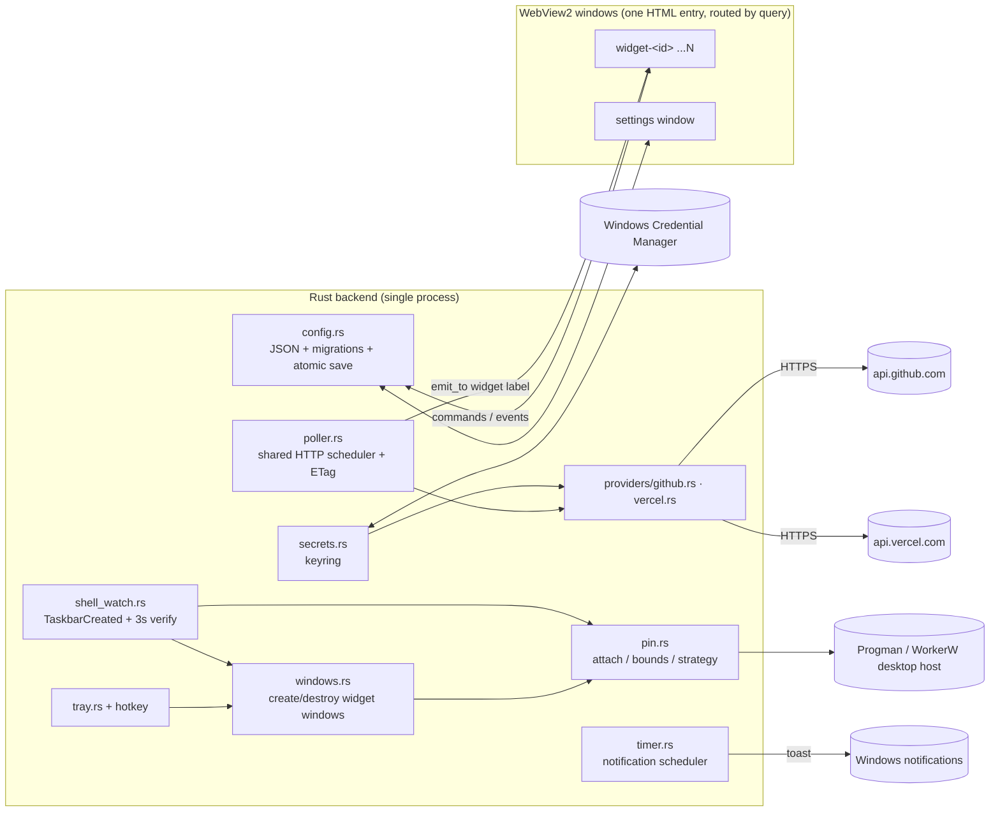
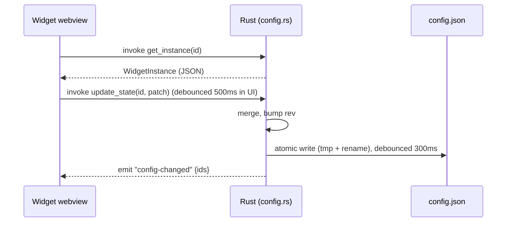
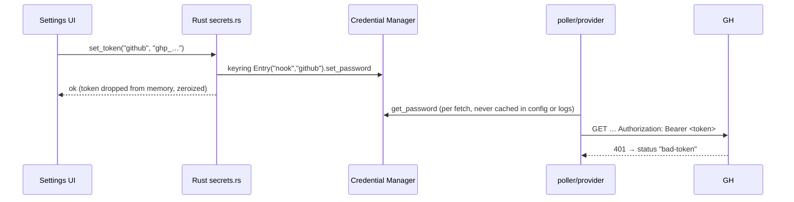

# Nook — Implementation Plan

> Generated by tech-architect-planner
> Date: 2026-11-17
> App name: **Nook** (identifier `com.nook.app`, crate `nook`, repo `nook`).
> **Assumptions are flagged inline with ⚠️ ASSUMPTION:**
> Target reader: an AI coding agent (Antigravity) with zero prior context.

---

## 1. Project Overview

**Purpose.** A Windows-only desktop widget app. Small borderless widgets (Notes, Timer, GitHub Repo, Vercel Project) sit on the desktop layer, below app windows, and survive Win+D and "hide desktop icons". It is a lightweight alternative to Rainmeter and Windows 11 Widgets. There is no wizard and no heavy configuration: tray icon → Add widget → done.

**Goals**

- One click to add a widget; drag and resize in an explicit "edit layout" mode.
- **Tray-only app:** Nook lives in the system tray (notification area) while running. It never shows a taskbar button or Alt+Tab entry for any window, including the Settings window. There is no main window; closing Settings does not quit the app (only tray → Quit does).
- Widgets never appear in the taskbar or Alt+Tab and, by default, never cover app windows.
- **Always on top (per widget):** any widget can be switched to stay above all other windows via right-click → "Always on top" (checkable) or its Settings.
- Layout restored exactly on launch; the app also self-heals after an explorer.exe restart.
- Tiny footprint: one shared Rust poller, no per-widget timers for network work, near-zero idle CPU.
- Adding a widget type means adding one folder plus two registry lines.

**Success criteria** (all manual; no automated tests, see §12)

- All Phase 1–6 acceptance criteria in §15 pass on Windows 10 1809+ and Windows 11 (23H2 and 24H2+).
- Idle CPU < 1 % with all four widget types open; no secret appears in `config.json` or logs.
- A push to `main` produces a downloadable NSIS installer `.exe` in GitHub Actions.

**Out of scope for v1**

- Automated tests (explicitly requested), markdown rendering in Notes, real acrylic/Mica blur, marketplace or third-party widget loading, macOS/Linux, auto-update, multi-profile layouts.

---

## 2. Tech Stack

Versioning policy: at scaffold time, record the exact resolved versions from `package-lock.json` / `Cargo.lock` in the README "Stack" table and pin them (`--save-exact`, no `^`). ⚠️ ASSUMPTION: the table gives the minimum major versions known at planning time; use the latest compatible release in that major and pin it.

| Layer                   | Technology                                                                  | Version                       | Rationale                                                                                                                                                                                                                         |
| ----------------------- | --------------------------------------------------------------------------- | ----------------------------- | --------------------------------------------------------------------------------------------------------------------------------------------------------------------------------------------------------------------------------- |
| Shell                   | Tauri                                                                       | 2.x                           | Required. Multi-window, tray, plugins.                                                                                                                                                                                            |
| Backend                 | Rust stable + `windows` crate                                               | latest stable; `windows` 0.6x | Win32 desktop attach. Native, no extra runtime.                                                                                                                                                                                   |
| Frontend                | **React 19 + Vite + TypeScript (strict)**                                   | React 19, Vite 7+             | Justification: oxlint's React/hooks rules are first-class, the component-per-widget model maps 1:1 to the plugin interface, and the per-webview footprint difference vs Svelte is negligible next to the WebView2 process itself. |
| Styling                 | Tailwind CSS v4 + `@tailwindcss/vite`                                       | 4.x                           | Required. CSS-first `@theme` tokens, no `tailwind.config.js`.                                                                                                                                                                     |
| HTTP                    | `reqwest` (rustls, json, no default features)                               | 0.12+                         | Shared poller, ETag support.                                                                                                                                                                                                      |
| Async                   | `tokio` (rt, time, sync, macros)                                            | 1.x                           | Poller + timer scheduling.                                                                                                                                                                                                        |
| Secrets                 | `keyring` with `windows-native` feature                                     | 3.x                           | Windows Credential Manager.                                                                                                                                                                                                       |
| Tauri plugins           | `single-instance`, `autostart`, `global-shortcut`, `notification`, `opener` | 2.x                           | One plugin per requirement.                                                                                                                                                                                                       |
| Serialization           | `serde`, `serde_json`                                                       | 1.x                           | Config + IPC.                                                                                                                                                                                                                     |
| Logging                 | `tracing`, `tracing-subscriber`, `tracing-appender`                         | latest                        | File log in app log dir, never secrets.                                                                                                                                                                                           |
| Lint (TS)               | `oxlint`                                                                    | latest                        | Required.                                                                                                                                                                                                                         |
| Format (TS/CSS/JSON/MD) | `prettier` + `prettier-plugin-tailwindcss`                                  | 3.x                           | Required.                                                                                                                                                                                                                         |
| Format/lint (Rust)      | `rustfmt`, `clippy`                                                         | with toolchain                | Required.                                                                                                                                                                                                                         |
| Git hooks               | `husky` + `lint-staged`                                                     | latest                        | Required.                                                                                                                                                                                                                         |
| CI                      | GitHub Actions, `windows-latest`                                            | n/a                           | Required.                                                                                                                                                                                                                         |

Global install: Rust (rustup), Node 22 LTS+, GitHub CLI (`gh`, authenticated), WebView2 Runtime (preinstalled on Win11; the installer bootstraps it on Win10).
Everything else is a project dependency.

---

## 3. System Architecture



### 3.1 How widget windows are created and pinned

1. `windows::spawn_widget(instance)` builds a `WebviewWindowBuilder` with label `widget-<id>`, URL `index.html?w=<id>`, `decorations(false)`, `skip_taskbar(true)`, `resizable(false)` (resizing is custom), `shadow(false)`, `focused(false)`, `visible(false)`, `transparent(false)`.
2. Rust grabs the HWND, calls `pin::attach(hwnd)`, applies saved bounds with `pin::set_bounds`, then shows the window.
3. `shell_watch` keeps it attached (explorer restarts, shell layout changes).

### 3.2 ⚠️ KEY DECISION — which desktop layer, and why this deviates from the brief

The brief says: send `0x052C` to Progman, find the WorkerW, `SetParent` into it.
That places windows **behind the desktop icon layer** (`SHELLDLL_DefView`). `DefView` covers the whole screen and swallows every mouse click, so a widget parented behind it is visible but **cannot receive mouse or keyboard input**. That would break the Notes (typing), Timer (buttons) and the clickable links in the GitHub/Vercel widgets. Forwarding input there (mouse hooks plus synthetic DOM events) can never deliver keyboard focus.

**Chosen design (`PinStrategy::AboveIcons`, default):** parent each widget to the window that _hosts_ `SHELLDLL_DefView` and z-order it **just above DefView**, so it is a sibling in the desktop layer, not behind it.

- Hosts the desktop's windows: Win11 24H2+ and default Win10 layout → host is `Progman`. Win10/Win11 ≤ 23H2 _after_ a wallpaper engine or slideshow has triggered `0x052C` → host is a top-level `WorkerW` containing `DefView`.
- Detection (no message sent): enumerate top-level `WorkerW` windows for a `SHELLDLL_DefView` child; if none, use `Progman` if it has the child. This handles both the classic and the 24H2 hierarchy with one rule: **parent = DefView's parent**.
- Behaviour: stays visible with icons hidden (only the DefView child is hidden), stays on Win+D (children of the desktop are not minimized), is never in the taskbar or Alt+Tab (child windows), never above app windows (the whole desktop layer is below them). Widgets cover the desktop icons beneath them. This is expected widget behaviour (same as Windows 7 gadgets). Users can move them.
- We deliberately never send `0x052C`: it restructures the shell and can fight wallpaper apps (Lively, Wallpaper Engine).
- **Rejected for v1:** `BehindIcons` (spec-literal WorkerW behind DefView). It is documented in the README as an option, not implemented.

**Per-widget "Always on top" (`PinStrategy::Topmost`):** a window that is a child of the desktop layer can never be above app windows, so enabling this _detaches_ the widget and turns it into a normal top-level window:

1. `SetParent(hwnd, None)`, then restore styles (clear `WS_CHILD`, set `WS_POPUP`), keep `WS_EX_TOOLWINDOW` (so still no taskbar/Alt+Tab entry) and `WS_EX_LAYERED` (opacity still works).
2. `SetWindowPos(hwnd, HWND_TOPMOST, …, SWP_NOACTIVATE)`, converting the stored bounds back to **screen** coordinates.
3. Disabling reverses it: clear `HWND_TOPMOST` (`HWND_NOTOPMOST`), `attach()` back to the desktop layer.
   `pin::set_bounds_screen` branches on the window's current mode (client coords when parented, screen coords when top-level); callers never care. `shell_watch::ensure_all` skips the DefView-parent check for `alwaysOnTop` widgets (it only verifies they still exist and are `HWND_TOPMOST`). Toggling is persisted in `alwaysOnTop`; a small pin glyph appears in the widget header (and in edit mode) as the only visual indicator. This feature also works when the global strategy is `BottomToplevel`.

**Fallback (`PinStrategy::BottomToplevel`):** if attach fails, or the Phase 1 gate (§15) shows keyboard input does not work in a desktop child, widgets become top-level `WS_EX_TOOLWINDOW | WS_EX_NOACTIVATE` windows inserted at the bottom of the z-order (immediately above the desktop group), kept there by a `SetWinEventHook(EVENT_SYSTEM_FOREGROUND)` keeper that re-asserts z-order and visibility after Win+D / focus changes. Strategy is chosen once at startup (`auto`) and can be forced in `config.json` (`app.pinStrategy`: `"auto" | "above-icons" | "bottom"`). Document in README.

### 3.3 Config data flow

Rust is the **single source of truth**. The webview never writes files.



### 3.4 Widget plugin interface (summary; full definition in §5.3)

A widget = a folder `src/widgets/<type>/` with `manifest.json` (single source for TS and Rust), `index.tsx` (`WidgetModule`), and optionally `src-tauri/src/providers/<x>.rs`. Registered with one line in `src/widgets/registry.ts` and one in `src-tauri/src/registry.rs` (`include_str!` of the manifest, which powers the tray "Add widget" submenu and default sizes).

### 3.5 Edit mode and input model

- **Edit off (normal):** widgets are fully interactive (they sit above the icon layer, so no click-through trick is needed). There is no click-through; background clicks on a widget do nothing.
- **Edit on:** each widget shows a 24 px drag bar, edge/corner resize zones and an accent outline. An overlay with `pointer-events: all` covers the content so nothing is clicked by accident.
- **Why custom drag/resize:** `startDragging()` / `HTCAPTION` do not work for `WS_CHILD` windows. The UI captures the pointer (`setPointerCapture`), computes the new screen rect from `PointerEvent.screenX/screenY`, and calls `invoke("set_bounds", …)`, rAF-throttled. Rust clamps (monitor work area, manifest min size), snaps (grid, default 8 px, toggleable), converts to host-client coordinates and calls `SetWindowPos`. On `pointerup`, Rust persists.
- Toggle: tray check item "Edit layout" and global hotkey (default `Ctrl+Alt+E`, configurable).

---

## 4. Project Structure

```
nook/
├── .agent/                         # Antigravity workspace rules (see §11)
│   └── rules/
│       ├── readme-sync.md
│       ├── code-standards.md
│       └── no-cheap-fixes.md
├── .github/workflows/build.yml     # lint + build NSIS installer on push
├── .husky/pre-commit               # runs lint-staged
├── .gitignore                      # includes .planning/ and docs/ (local-only, never committed)
├── .oxlintrc.json
├── .prettierrc.json
├── .prettierignore
├── lint-staged.config.mjs
├── icon.png                        # PROVIDED by the user: master app icon (1024×1024, transparent). Do not regenerate or edit
├── banner.webp                      # PROVIDED by the user: GitHub README banner. Do not regenerate or edit
├── README.md                       # kept in sync (rule), shows banner.webp at top, includes "Add a widget" guide
├── index.html                      # single entry for all windows
├── package.json
├── tsconfig.json                   # strict, noUncheckedIndexedAccess
├── vite.config.ts                  # react + @tailwindcss/vite, port 1420
├── src/
│   ├── main.tsx                    # routes by ?w=<id> (widget) or ?view=settings
│   ├── styles/theme.css            # Tailwind v4 tokens (see §8.2) — single stylesheet
│   ├── core/
│   │   ├── ipc.ts                  # typed invoke/listen wrappers
│   │   ├── types.ts                # WidgetInstance, Manifest, SettingsField, AppConfig
│   │   ├── use-instance.ts         # hook: instance + settings + state patch (debounced)
│   │   ├── use-provider.ts         # hook: subscribe to Rust poller data/status
│   │   ├── use-theme.ts            # applies .dark class from config
│   │   └── use-edit-mode.ts
│   ├── components/
│   │   ├── WidgetShell.tsx         # card chrome, header slot, status banner, context menu
│   │   ├── EditOverlay.tsx         # drag bar + resize zones
│   │   ├── StatusDot.tsx
│   │   ├── Banner.tsx              # offline / bad token / rate limited
│   │   └── SettingsForm.tsx        # renders manifest.settings schema
│   ├── settings/SettingsApp.tsx    # General + Accounts + per-widget form
│   └── widgets/
│       ├── registry.ts
│       ├── notes/{manifest.json,index.tsx}
│       ├── timer/{manifest.json,index.tsx}
│       ├── github-repo/{manifest.json,index.tsx}
│       └── vercel-project/{manifest.json,index.tsx}
└── src-tauri/
    ├── Cargo.toml
    ├── build.rs
    ├── rustfmt.toml
    ├── tauri.conf.json
    ├── capabilities/{widget.json,settings.json}
    ├── icons/                      # generated from ../icon.png by `npm run tauri icon icon.png` (commit the output)
    └── src/
        ├── main.rs                 # thin: calls lib::run()
        ├── lib.rs                  # builder, plugins, setup, command registration
        ├── state.rs                # AppState (config, edit_mode, pinner, poller)
        ├── config.rs               # load/save/migrate, debounce, atomic write
        ├── migrations.rs           # Vec<fn(Value)->Value>
        ├── registry.rs             # include_str! manifests
        ├── windows.rs              # spawn/destroy/duplicate widget windows
        ├── pin.rs                  # attach, strategy, bounds, opacity, region
        ├── shell_watch.rs          # hidden window: TaskbarCreated, WM_DISPLAYCHANGE, 3s verify
        ├── tray.rs                 # tray + menu + edit toggle
        ├── commands.rs             # all #[tauri::command]
        ├── secrets.rs              # keyring wrappers (never returns token)
        ├── poller.rs               # shared scheduler, ETag cache, rate-limit handling
        ├── timer.rs                # notification scheduling for Timer widget
        └── providers/{mod.rs,github.rs,vercel.rs}
```

### 4.1 Brand assets (`icon.png`, `banner.webp`)

Both files are supplied by the user and already sit in the **repo root** before work starts. If either is missing, stop and ask; never invent a substitute.

| File          | Used for                                                    | How                                                                                                                                                                                                                                                                                                                                    |
| ------------- | ----------------------------------------------------------- | -------------------------------------------------------------------------------------------------------------------------------------------------------------------------------------------------------------------------------------------------------------------------------------------------------------------------------------- |
| `icon.png`    | Installer, exe, tray, Settings window, favicon              | Phase 0: run `npm run tauri icon icon.png` to generate `src-tauri/icons/*` (`.ico`, `.icns`, PNG sizes) referenced by `tauri.conf.json` `bundle.icon`. Tray icon: load `src-tauri/icons/32x32.png` via `tray::icon()` (`Image::from_bytes`, `image-png` feature). Settings window: `WebviewWindowBuilder::icon(...)` with the same PNG |
| `banner.webp` | GitHub README header only (WebP renders natively on GitHub) | Embed at the top of `README.md`: `<p align="center"></p>`. Do **not** bundle it into the app or the installer                                                                                                                                                                                      |

Rules

- Do not crop, recolor, resize or re-export either file. Derived icon sizes come only from the Tauri CLI.
- Neither file is processed by Prettier (listed in `.prettierignore`) or linted.
- If the 32 px tray icon looks muddy on a dark or light taskbar, report it and ask for a simplified/monochrome `icon-tray.png`; do not hand-edit.
- The README banner is referenced with a relative path so it renders on GitHub without hosting.

---

## 5. Data Models & Schema

### 5.1 `config.json` (app data dir: `%APPDATA%\com.nook.app\config.json`)

Versioned schema, Rust-owned. Secrets never live here.

```jsonc
{
  "version": 1,
  "app": {
    "theme": "system", // "system" | "light" | "dark"
    "autostart": false,
    "editHotkey": "Ctrl+Alt+E",
    "gridSnap": 8, // px, 0 = off
    "pinStrategy": "auto", // "auto" | "above-icons" | "bottom"
  },
  "widgets": [
    {
      "id": "w_01HZX...", // uuid v4 string
      "type": "notes", // manifest id
      "rect": { "x": 120, "y": 80, "w": 260, "h": 220 }, // logical px (DIP), RELATIVE to monitor top-left
      "monitor": { "name": "\\\\.\\DISPLAY1", "originX": 0, "originY": 0 }, // identity + fallback
      "opacity": 0.95, // 0.3–1.0
      "alwaysOnTop": false, // true = top-level topmost window instead of desktop-layer child
      "settings": {}, // validated against manifest.settings
      "state": {}, // widget-owned runtime data (notes text, timer state)
    },
  ],
}
```

**Rules**

- Positions are stored per monitor in logical px. Physical px = logical × scale factor of the target monitor at apply time.
- On load, `monitor.name` is looked up in `available_monitors()`. If missing, fall back to the monitor whose origin matches, else the primary, then clamp to its work area.
- Writes: serialize → write `config.json.tmp` → `rename`. Debounce 300 ms. Flush on quit. Keep `config.json.bak` of the previous good file.
- Migrations: `migrations::MIGRATIONS: &[fn(Value) -> Value]`; `MIGRATIONS[n]` upgrades version n → n+1. Load runs all pending, then deserializes. Unknown/corrupt file → rename to `config.corrupt-<ts>.json` and start fresh (never crash).
- Per-widget limits: `state` ≤ 256 KB serialized (Notes enforces 100 KB text).

### 5.2 Rust types (`config.rs`)

```rust
#[derive(Serialize, Deserialize, Clone)]
pub struct AppConfig { pub version: u32, pub app: AppSection, pub widgets: Vec<WidgetInstance> }

#[derive(Serialize, Deserialize, Clone)]
pub struct WidgetInstance {
    pub id: String,
    #[serde(rename = "type")] pub kind: String,
    pub rect: Rect,                  // logical, monitor-relative
    pub monitor: MonitorRef,
    pub opacity: f32,
    #[serde(default)] pub always_on_top: bool,   // serialized as "alwaysOnTop" (rename_all camelCase)
    pub settings: serde_json::Map<String, serde_json::Value>,
    pub state: serde_json::Map<String, serde_json::Value>,
}
```

### 5.3 TypeScript plugin interface (`src/core/types.ts`)

```ts
export type SettingsField =
  | { key: string; label: string; type: "text"; default: string; placeholder?: string }
  | { key: string; label: string; type: "number"; default: number; min?: number; max?: number }
  | {
      key: string;
      label: string;
      type: "select";
      default: string;
      options: { value: string; label: string }[];
    }
  | { key: string; label: string; type: "toggle"; default: boolean };

export interface Manifest {
  id: string; // "notes"
  name: string; // "Notes"
  defaultSize: { w: number; h: number };
  minSize: { w: number; h: number };
  settings: SettingsField[];
  provider?: "github" | "vercel"; // present if a Rust provider feeds this widget
}

export interface WidgetProps<S = Record<string, unknown>, T = Record<string, unknown>> {
  id: string;
  settings: S; // already merged with manifest defaults
  state: T;
  patchState: (patch: Partial<T>) => void; // debounced 500ms, persisted by Rust
  editMode: boolean;
}

export interface WidgetModule {
  manifest: Manifest; // imported from ./manifest.json
  Component: React.ComponentType<WidgetProps>;
}
```

`src/widgets/registry.ts`:

```ts
import * as notes from "./notes";
import * as timer from "./timer";
import * as githubRepo from "./github-repo";
import * as vercelProject from "./vercel-project";
import type { WidgetModule } from "../core/types";

export const registry: Record<string, WidgetModule> = Object.fromEntries(
  [notes, timer, githubRepo, vercelProject].map((m) => [m.default.manifest.id, m.default]),
);
```

### 5.4 Provider payloads (emitted by Rust to the widget window)

```ts
type ProviderStatus =
  "ok" | "loading" | "offline" | "bad-token" | "no-token" | "rate-limited" | "not-found" | "error";
interface ProviderEvent<T> {
  status: ProviderStatus;
  data?: T;
  updatedAt?: number;
  retryAt?: number;
  message?: string;
}

interface GithubData {
  commits: { sha: string; message: string; author: string; date: string; url: string }[];
  runs: {
    id: number;
    name: string;
    branch: string;
    status: string;
    conclusion: string | null;
    url: string;
    startedAt: string;
  }[];
}
interface VercelData {
  deployments: {
    id: string;
    name: string;
    state: "BUILDING" | "READY" | "ERROR" | "QUEUED" | "CANCELED" | "INITIALIZING";
    url: string | null;
    branch: string | null;
    createdAt: number;
    target: string | null;
  }[];
}
```

---

## 6. API Design (Tauri commands and events — no HTTP server)

### Commands (`commands.rs`; registered in `lib.rs`)

| Command                           | Args                               | Returns                                         | Purpose                                                                                         |
| --------------------------------- | ---------------------------------- | ----------------------------------------------- | ----------------------------------------------------------------------------------------------- |
| `get_app_config`                  | —                                  | `AppConfig` (no widgets' state bodies > 256 KB) | Settings window                                                                                 |
| `get_instance`                    | `id`                               | `WidgetInstance`                                | Widget boot                                                                                     |
| `list_manifests`                  | —                                  | `Manifest[]`                                    | Tray + settings (from `registry.rs`)                                                            |
| `add_widget`                      | `type`                             | `WidgetInstance`                                | Create with manifest defaults, placed at cursor monitor center, staggered                       |
| `duplicate_widget`                | `id`                               | `WidgetInstance`                                | Copy settings+state, offset 24 px                                                               |
| `remove_widget`                   | `id`                               | —                                               | Destroy window, drop instance, cancel provider/timer                                            |
| `update_settings`                 | `id, patch`                        | —                                               | Validate against manifest, persist, emit `config-changed`                                       |
| `update_state`                    | `id, patch`                        | —                                               | Persist (size-capped)                                                                           |
| `set_opacity`                     | `id, value`                        | —                                               | `SetLayeredWindowAttributes` + persist                                                          |
| `set_always_on_top`               | `id, on`                           | —                                               | Switch between desktop-layer child and topmost top-level (§3.2), persist, emit `config-changed` |
| `set_bounds`                      | `id, x, y, w, h, commit`           | —                                               | Screen-space rect → clamp/snap → `SetWindowPos`; persist if `commit`                            |
| `set_edit_mode`                   | `on`                               | —                                               | Toggle, emit `edit-mode`, update tray check                                                     |
| `update_app_settings`             | `patch`                            | —                                               | theme, autostart (calls plugin), hotkey (re-register), gridSnap, pinStrategy                    |
| `open_settings`                   | `widgetId?`                        | —                                               | Show/create the settings window                                                                 |
| `set_token`                       | `provider, token`                  | —                                               | Store in Credential Manager; triggers poller refresh                                            |
| `has_token` / `clear_token`       | `provider`                         | `bool` / —                                      | Never returns the token                                                                         |
| `provider_snapshot`               | `id`                               | `ProviderEvent`                                 | Last-known data for instant paint                                                               |
| `refresh_provider`                | `id`                               | —                                               | Manual refresh (rate-limited to 1/10 s)                                                         |
| `timer_schedule` / `timer_cancel` | `id, endsAtMs, title, body` / `id` | —                                               | Notification scheduling                                                                         |
| `open_external`                   | `url`                              | —                                               | Only `https://github.com/**`, `https://vercel.com/**`, `https://*.vercel.app/**`                |

All commands return `Result<T, String>` with short, user-safe messages (no tokens, no raw response bodies).

### Events (Rust → webview)

| Event            | Target                       | Payload                        |
| ---------------- | ---------------------------- | ------------------------------ |
| `config-changed` | all windows                  | `{ ids: string[], app: bool }` |
| `edit-mode`      | all windows                  | `{ on: boolean }`              |
| `provider-data`  | the subscribing widget label | `ProviderEvent<T>`             |

---

## 7. Authentication & Secrets

No app login. Only two API tokens (GitHub PAT, Vercel token).



- Keyring entries: service `nook`, user `github` / `vercel`. One token per provider, shared by all widgets of that type.
- The token field is `type=password`, cleared after save; the UI only ever shows "Token saved ✓" via `has_token`.
- Logging: a `redact()` helper is mandatory for any URL/header logging; never log request headers or bodies. `tracing` fields for providers are limited to provider name, status code, rate-limit remaining.
- Recommended scopes (shown in the settings hint): GitHub fine-grained PAT, read-only `Contents`, `Actions`, `Metadata`. Vercel token read access to the project's team.

---

## 8. UI/UX Specification

### 8.1 Screens

| Screen                                                                                                                                               | Entry                                          | Notes                                                                                                                                                                                                                                   |
| ---------------------------------------------------------------------------------------------------------------------------------------------------- | ---------------------------------------------- | --------------------------------------------------------------------------------------------------------------------------------------------------------------------------------------------------------------------------------------- |
| Widget windows (4 types)                                                                                                                             | Tray → Add widget                              | Card chrome from `WidgetShell`                                                                                                                                                                                                          |
| Settings window (single, ~480×560, normal top-level, **`skip_taskbar(true)`**, closing it destroys the window but the app keeps running in the tray) | Tray → Settings, widget right-click → Settings | Sections: **General** (theme, startup toggle, edit hotkey, grid snap), **Accounts** (GitHub, Vercel token), **Widget** (auto-generated from `manifest.settings` + opacity slider + "Always on top" toggle) when opened with a widget id |
| Tray menu                                                                                                                                            | Always                                         | **Add widget ▸** (one item per manifest), **Edit layout** (checkable), **Settings**, **Quit**                                                                                                                                           |
| Widget context menu (native)                                                                                                                         | Right-click on a widget                        | **Always on top** (checkable), **Settings**, **Duplicate**, **Remove**                                                                                                                                                                  |

States for every data widget: loading (skeleton lines), empty, populated, and banner states: _No token — open Settings_, _Invalid token_, _Offline — showing last data_, _Rate limited — retry in N min_, _Repo/project not found_.

Interactions and motion: fade+4 px translate on appear (150 ms), 120 ms hover on interactive controls, edit-mode outline fades in. Nothing loops; the only repeating animation is the "building" dot pulse (disabled by `prefers-reduced-motion`).

### 8.2 Design tokens — Tailwind v4, CSS-first (`src/styles/theme.css`, the only stylesheet)

Neutral scheme (zinc-like OKLCH scale). **One** accent hue used sparingly: primary action, focus ring, edit-mode outline and the selected state. Status colors are muted and used only on small dots/text.

```css
@import "tailwindcss";

/* class-based dark mode, toggled on <html> by use-theme.ts */
@custom-variant dark (&:where(.dark, .dark *));

@theme {
  /* Replace the default palette so only our tokens exist */
  --color-*: initial;

  /* Neutral scale */
  --color-neutral-0: oklch(1 0 0);
  --color-neutral-50: oklch(0.985 0.002 260);
  --color-neutral-100: oklch(0.967 0.003 260);
  --color-neutral-200: oklch(0.92 0.004 260);
  --color-neutral-300: oklch(0.87 0.005 260);
  --color-neutral-400: oklch(0.71 0.007 260);
  --color-neutral-500: oklch(0.55 0.01 260);
  --color-neutral-600: oklch(0.44 0.01 260);
  --color-neutral-700: oklch(0.37 0.01 260);
  --color-neutral-800: oklch(0.27 0.008 260);
  --color-neutral-900: oklch(0.21 0.007 260);
  --color-neutral-950: oklch(0.15 0.006 260);

  /* Single accent (restrained blue) */
  --color-accent-400: oklch(0.72 0.12 255);
  --color-accent-500: oklch(0.63 0.16 255);
  --color-accent-600: oklch(0.55 0.17 255);

  /* Muted status colors — dots/text only */
  --color-ok: oklch(0.68 0.12 155);
  --color-warn: oklch(0.78 0.13 80);
  --color-danger: oklch(0.63 0.17 25);

  --font-sans: "Segoe UI Variable Text", "Segoe UI", system-ui, sans-serif;
  --font-mono: "Cascadia Mono", ui-monospace, monospace;

  --text-xs: 0.75rem;
  --text-xs--line-height: 1.1rem;
  --text-sm: 0.8125rem;
  --text-sm--line-height: 1.25rem;
  --text-base: 0.875rem;
  --text-base--line-height: 1.375rem;
  --text-lg: 1.125rem;
  --text-lg--line-height: 1.5rem;
  --text-display: 2rem;
  --text-display--line-height: 2.25rem;

  --radius-sm: 0.375rem;
  --radius-md: 0.5rem;
  --radius-card: 0.75rem;

  --shadow-card: 0 1px 2px oklch(0 0 0 / 0.06), 0 4px 16px oklch(0 0 0 / 0.08);

  --ease-soft: cubic-bezier(0.2, 0.8, 0.2, 1);
  --animate-appear: appear 150ms var(--ease-soft) both;
  --animate-pulse-dot: pulse-dot 1.4s ease-in-out infinite;

  @keyframes appear {
    from {
      opacity: 0;
      transform: translateY(4px);
    }
    to {
      opacity: 1;
      transform: none;
    }
  }
  @keyframes pulse-dot {
    50% {
      opacity: 0.35;
    }
  }
}

/* Semantic tokens: the ONLY colors components may use */
:root {
  --surface: var(--color-neutral-0);
  --surface-raised: var(--color-neutral-100);
  --fg: var(--color-neutral-900);
  --fg-muted: var(--color-neutral-500);
  --line: var(--color-neutral-200);
  --focus: var(--color-accent-500);
}
.dark {
  --surface: var(--color-neutral-900);
  --surface-raised: var(--color-neutral-800);
  --fg: var(--color-neutral-50);
  --fg-muted: var(--color-neutral-400);
  --line: var(--color-neutral-700);
  --focus: var(--color-accent-400);
}

@theme inline {
  --color-surface: var(--surface);
  --color-surface-raised: var(--surface-raised);
  --color-fg: var(--fg);
  --color-fg-muted: var(--fg-muted);
  --color-line: var(--line);
  --color-focus: var(--focus);
}

@layer base {
  html,
  body,
  #root {
    height: 100%;
    margin: 0;
  }
  body {
    @apply bg-surface font-sans text-base text-fg antialiased select-none;
  }
  textarea,
  input {
    @apply select-text;
  }
  @media (prefers-reduced-motion: reduce) {
    *,
    ::before,
    ::after {
      animation: none !important;
      transition: none !important;
    }
  }
}
```

Component rules: use semantic utilities (`bg-surface`, `text-fg-muted`, `border-line`, `ring-focus`); raw palette utilities (`bg-neutral-500`) are not allowed outside `theme.css`. Accent appears only via `bg-accent-500` (primary button), `ring-focus`, and the edit outline. No gradients.

**"Glass" look, honestly scoped:** the WebView cannot blur the desktop behind it, so v1 achieves the Windows 11 feel with per-widget window opacity (`WS_EX_LAYERED` alpha, 0.3–1.0, default 0.95), a hairline `border-line`, `rounded-card`, and `shadow-card`. Real Mica/Acrylic is out of scope. ⚠️ ASSUMPTION: this is acceptable for "simple".

**Window corners:** the window region is a rounded rect (`CreateRoundRectRgn`, radius = 12 px × scale) via `SetWindowRgn`. This is slightly aliased on the edge. Documented limitation.

---

## 9. Business Logic

### 9.0 Tray-only lifecycle (`lib.rs`, `tray.rs`)

- `tauri.conf.json` declares no windows; the tray icon is created in `setup` and is the only persistent UI. Every window Rust creates (widgets, settings) sets `skip_taskbar(true)`.
- Handle `RunEvent::ExitRequested { api, code, .. }`: if `code.is_none()` (last window closed) call `api.prevent_exit()`, so closing Settings never quits. Only the tray "Quit" item calls `app.exit(0)` after flushing config.
- Tray left-click opens the menu (or Settings on double-click). Tray tooltip: "Nook". Use `show_menu_on_left_click(true)`.
- On Windows the tray icon may be hidden in the overflow chevron by default; add a README line telling the user to drag it onto the visible tray area.
- Autostart launches straight to tray + restored widgets with no window flash.

### 9.1 Add widget (tray)

1. Tray item `add:<type>` → `commands::add_widget(type)`.
2. Look up manifest; build `WidgetInstance` with `defaultSize`, settings = defaults, opacity 0.95.
3. Place on the monitor under the cursor: centered, offset `24 px × (count of widgets on that monitor mod 6)`.
4. `windows::spawn_widget` → attach → bounds → show. Save config.

### 9.2 Attach (`pin.rs`) — reference sketch (verify signatures against the pinned `windows` version)

```rust
pub enum PinStrategy { AboveIcons, BottomToplevel }

pub fn find_defview_host() -> Option<HWND> {
    // 1. any top-level WorkerW that owns SHELLDLL_DefView (classic layout after 0x052C-style shell changes)
    // 2. else Progman if it owns SHELLDLL_DefView (default Win10, Win11 24H2+)
}

pub fn attach(hwnd: HWND, opacity: f32) -> windows::core::Result<PinStrategy> {
    unsafe {
        let host = find_defview_host().ok_or_else(|| Error::from(E_FAIL))?;
        SetParent(hwnd, Some(host))?;                       // 1) reparent FIRST (MSDN)
        let mut s = GetWindowLongPtrW(hwnd, GWL_STYLE);     // 2) then fix styles
        s = (s & !(WS_POPUP.0 as isize)) | WS_CHILD.0 as isize | WS_CLIPSIBLINGS.0 as isize;
        SetWindowLongPtrW(hwnd, GWL_STYLE, s);
        let mut ex = GetWindowLongPtrW(hwnd, GWL_EXSTYLE);
        ex = (ex | WS_EX_TOOLWINDOW.0 as isize | WS_EX_LAYERED.0 as isize) & !(WS_EX_APPWINDOW.0 as isize);
        SetWindowLongPtrW(hwnd, GWL_EXSTYLE, ex);
        let _ = SetLayeredWindowAttributes(hwnd, COLORREF(0), (opacity * 255.0) as u8, LWA_ALPHA);
        SetWindowPos(hwnd, Some(HWND_TOP), 0, 0, 0, 0,      // above DefView, among desktop siblings
            SWP_NOMOVE | SWP_NOSIZE | SWP_NOACTIVATE | SWP_FRAMECHANGED)?;
        Ok(PinStrategy::AboveIcons)
    }
}

/// Screen-space physical rect -> host client coords. ALL geometry goes through here;
/// never use tauri's set_position (it assumes top-level/screen coords).
pub fn set_bounds_screen(hwnd: HWND, r: RECT) { /* ScreenToClient(host, &mut pt); SetWindowPos(hwnd, None, x,y,w,h, SWP_NOZORDER|SWP_NOACTIVATE); SetWindowRgn(rounded) */ }

pub fn verify(hwnd: HWND) -> bool { /* IsWindow && GetParent == find_defview_host() */ }
```

Fallback `attach_bottom(hwnd)`: keep top-level; set `WS_EX_TOOLWINDOW | WS_EX_NOACTIVATE | WS_EX_LAYERED`; `SetWindowPos` immediately above the desktop group; start the foreground-event keeper. ⚠️ ASSUMPTION: z-order "just above desktop" needs empirical tuning on the user's machine in Phase 1; document the final recipe in the README.

### 9.3 Shell watch (`shell_watch.rs`)

- One dedicated thread creates a **hidden top-level** window (class `NookShellWatch`, `WS_EX_TOOLWINDOW`, never shown) and pumps messages. Message-only windows do _not_ receive broadcasts, so it must be a normal hidden window.
- `RegisterWindowMessageW("TaskbarCreated")` → on receipt: wait ~1 s for the shell to rebuild, then `ensure_all()`.
- `WM_DISPLAYCHANGE`, `WM_DPICHANGED`, `WM_SETTINGCHANGE` → `relayout_all()` (re-apply stored per-monitor bounds).
- `SetTimer` every 3 s → `ensure_all()` as a cheap safety net (a handful of `GetParent` calls). This also handles the DefView host changing after a wallpaper engine starts.
- `ensure_all()`: for each config widget → if its window/HWND no longer exists, recreate from config (`spawn_widget`); else if `!verify(hwnd)`, `attach` again; re-assert `HWND_TOP` among siblings. All Tauri/UI work is marshalled with `app.run_on_main_thread`.
- ⚠️ ASSUMPTION: when explorer dies, windows parented to its desktop may be destroyed. The `ensure_all` "recreate if gone" branch makes both outcomes safe; verify by killing explorer in Phase 2.

### 9.4 Edit mode

`set_edit_mode(on)` → state flag → emit `edit-mode` → tray check item updated. On `off`: persist all bounds, flush config. Drag/resize math is in Rust (`set_bounds`): clamp so ≥ 40 px of the widget stays within the work area of the monitor under its center; enforce manifest `minSize`; snap `x,y,w,h` to `gridSnap` when > 0; Alt held during the drag disables snapping (UI sends `snap:false`).

### 9.5 Poller (`poller.rs`) — one shared scheduler

1. `tokio` task with one `reqwest::Client` (rustls, 10 s timeout, `User-Agent: nook/<ver>`).
2. **Sources** are derived from config: key = `provider:resource:params`, e.g. `github:acme/app:n=5`. Two widgets with the same key share one fetch; subscribers = widget labels.
3. Reconcile sources on `config-changed` (add/remove/changed params) and on token set/clear.
4. Each source has `interval` (GitHub default 60 s, Vercel 30 s, min 15 s/30 s), `next_at`, `etag` (+ cached body), `backoff`.
5. Request sends `If-None-Match` when an ETag is cached; `304` → reuse cache (free against GitHub's rate limit), reset backoff.
6. Rate limits: GitHub `x-ratelimit-remaining == 0` → sleep until `x-ratelimit-reset`; `403/429` with `retry-after` → honor it. Vercel `429` → `x-ratelimit-reset`/`retry-after`. Emit `status: "rate-limited", retryAt`.
7. Errors: `401/403` (no limit headers) → `bad-token`; `404` → `not-found`; network error → `offline` (keep last data, exponential backoff 15 s→5 min, plus jitter); 5xx → `error` with backoff.
8. Results emitted with `emit_to(label, "provider-data", …)` and cached in memory for `provider_snapshot` (instant paint when a widget starts). Nothing is polled when no widget needs it. No per-widget timers in the webview for network work.

### 9.6 Widgets

**Notes** (`notes`) — settings: `fontSize` (number 11–20, default 13). Plain `<textarea>`, full-bleed, no border. `patchState({text})` debounced 500 ms. Cap 100 KB. Placeholder "Write something…". Header shows nothing but a tiny "saved" tick that fades after a save (no layout shift).

**Timer** (`timer`) — modes `countdown | stopwatch | pomodoro`. Settings: `mode`, `countdownMinutes` (default 10), `workMinutes` 25, `breakMinutes` 5, `longBreakMinutes` 15, `cyclesBeforeLong` 4, `notify` toggle.
State: `{ status: "idle"|"running"|"paused", endsAt?, startedAt?, accumulatedMs, phase?: "work"|"break"|"long", cycle? }`. Store timestamps, not ticks. The UI re-renders every 250 ms **only while running**; no tick when idle/paused.
Countdown/pomodoro: on start call `timer_schedule(id, endsAt, title, body)`; Rust holds a `tokio::time::sleep_until` task and fires a toast (`tauri-plugin-notification`) at the end; pause/reset → `timer_cancel`. Pomodoro auto-advances the phase on completion and waits for the user to press Start (no surprise auto-start). On app launch, reschedule running timers from state; one that expired while the app was closed is marked finished, no toast.
UI: large mono time, one primary button (accent), secondary reset. Mode switch is a 3-segment control.

**GitHub Repo** (`github-repo`) — settings: `repo` (`owner/name`, validated by regex), `commitCount` (1–20, default 5), `runCount` (1–10, default 3), `branch` (optional). Provider calls `GET /repos/{o}/{r}/commits?per_page=N[&sha=branch]` and `GET /repos/{o}/{r}/actions/runs?per_page=M[&branch=…]` with headers `Authorization: Bearer`, `Accept: application/vnd.github+json`, `X-GitHub-Api-Version: 2022-11-28`, `User-Agent`, ETag. UI: header repo name + status dot summarizing the latest run, a list of runs (status dot + name + branch + relative time) above a list of commits (message first line, author, relative time). Click opens the URL via `open_external`. ⚠️ ASSUMPTION: public repos work without a token at a lower rate limit, so `no-token` shows a soft hint rather than blocking.

**Vercel Project** (`vercel-project`) — settings: `project` (name or id), `teamId` (optional), `limit` (1–15, default 5). Provider calls `GET https://api.vercel.com/v6/deployments?projectId=…&limit=N[&teamId=…]`; if `project` is a name, resolve once via `GET /v9/projects/{name}` and cache the id. Statuses map: `BUILDING|INITIALIZING|QUEUED` → "building" (pulsing warn dot), `READY` → ok, `ERROR` → danger, `CANCELED` → muted. UI shows state dot, branch, `target` (production/preview), relative time; click opens the deployment URL.

---

## 10. External Integrations

| Service                            | Use                         | Auth                              | Notes                                                      |
| ---------------------------------- | --------------------------- | --------------------------------- | ---------------------------------------------------------- |
| GitHub REST API (`api.github.com`) | Commits, Actions runs       | PAT (Credential Manager)          | ETag + rate-limit headers honored; no SDK, plain `reqwest` |
| Vercel REST API (`api.vercel.com`) | Deployments, project lookup | Bearer token (Credential Manager) | No reliable ETags → fixed interval + 429 handling          |
| Windows Credential Manager         | Secret storage              | n/a                               | via `keyring`                                              |
| Windows notifications              | Timer toast                 | n/a                               | via `tauri-plugin-notification`                            |
| WebView2 Runtime                   | Rendering                   | n/a                               | NSIS bootstrapper installs when missing                    |

Failure behaviour for every integration is the status/banner matrix in §9.5 and §14.

---

## 11. Environment & Configuration

No `.env`. Runtime config is `config.json` (§5.1); secrets live in Credential Manager. Build-time env: none. CI uses only the default `GITHUB_TOKEN`.

### 11.1 Phase 0 — repo bootstrap commands (run in order; PowerShell)

```powershell
# 0.1 project folder + git
mkdir nook; cd nook
git init -b main

# 0.2 GitHub repo (private by default; use --public if preferred). Requires `gh auth login`.
gh repo create nook --private --source=. --remote=origin --description "Lightweight desktop widgets for Windows"

# 0.3 scaffold Tauri v2 + React + TS (non-interactive). The folder already holds icon.png/banner.webp; if the scaffolder
#     refuses a non-empty folder, scaffold into a temp folder and move its contents here WITHOUT overwriting those two files. ⚠️ verify flags against `npm create tauri-app@latest -- --help`
npm create tauri-app@latest . -- --template react-ts --manager npm --identifier com.nook.app --yes

# 0.4 Tailwind v4
npm i -D tailwindcss @tailwindcss/vite

# 0.5 TS lint + format
npm i -D oxlint prettier prettier-plugin-tailwindcss

# 0.6 Rust format + lint components
rustup component add rustfmt clippy

# 0.7 git hook tooling
npm i -D husky lint-staged
npx husky init            # creates .husky/pre-commit; overwrite its content below

# 0.8 .gitignore: local-only folders (keep the scaffold's existing entries, append these)
Add-Content .gitignore "`n# local-only planning and docs`n.planning/`ndocs/"

# 0.9 brand assets: icon.png and banner.webp must already be in the repo root (provided by the user).
#     Generate every icon size the bundler and tray need from icon.png:
if (!(Test-Path icon.png) -or !(Test-Path banner.webp)) { throw "icon.png and banner.webp are required in the repo root" }
npm run tauri icon icon.png

# 0.10 first commit
git add -A; git commit -m "chore: scaffold tauri v2 + react + tailwind v4"; git push -u origin main
```

`package.json` scripts (add/merge):

```json
{
  "scripts": {
    "dev": "vite",
    "build": "tsc && vite build",
    "tauri": "tauri",
    "lint": "oxlint --deny-warnings",
    "format": "prettier --write .",
    "format:check": "prettier --check .",
    "typecheck": "tsc --noEmit",
    "lint:rust": "cargo clippy --manifest-path src-tauri/Cargo.toml --all-targets -- -D warnings",
    "fmt:rust": "cargo fmt --manifest-path src-tauri/Cargo.toml",
    "fmt:rust:check": "cargo fmt --manifest-path src-tauri/Cargo.toml --check",
    "prepare": "husky"
  }
}
```

`.oxlintrc.json`:

```json
{
  "$schema": "./node_modules/oxlint/configuration_schema.json",
  "plugins": ["typescript", "react", "import"],
  "categories": { "correctness": "error", "suspicious": "warn" },
  "rules": {
    "no-console": "warn",
    "typescript/no-explicit-any": "error",
    "react/rules-of-hooks": "error",
    "react/exhaustive-deps": "warn"
  },
  "ignorePatterns": ["dist", "src-tauri/target", "src-tauri/gen"]
}
```

`.prettierrc.json`:

```json
{
  "printWidth": 100,
  "semi": true,
  "singleQuote": false,
  "trailingComma": "all",
  "plugins": ["prettier-plugin-tailwindcss"],
  "tailwindStylesheet": "./src/styles/theme.css"
}
```

`.prettierignore`: `dist`, `src-tauri/target`, `src-tauri/gen`, `package-lock.json`, `src-tauri/icons`, `icon.png`, `banner.webp`.

`src-tauri/rustfmt.toml`:

```toml
edition = "2021"
max_width = 100
```

`tsconfig.json` compilerOptions must include: `"strict": true, "noUncheckedIndexedAccess": true, "noImplicitOverride": true, "exactOptionalPropertyTypes": true, "resolveJsonModule": true, "verbatimModuleSyntax": true, "jsx": "react-jsx"`.

`lint-staged.config.mjs`:

```js
const cargo = "--manifest-path src-tauri/Cargo.toml";
export default {
  "*.{ts,tsx}": ["oxlint --deny-warnings", "prettier --write"],
  "*.{json,css,md,yml,yaml}": "prettier --write",
  "src-tauri/**/*.rs": [
    "rustfmt --edition 2021",
    () => `cargo clippy ${cargo} --all-targets -- -D warnings`,
  ],
};
```

`.husky/pre-commit`:

```sh
npx lint-staged
```

`.github/workflows/build.yml` (check current major versions of each action when writing; these are the minimum majors):

```yaml
name: build
on:
  push:
    branches: [main]
  pull_request:
  workflow_dispatch:

jobs:
  windows:
    runs-on: windows-latest
    steps:
      - uses: actions/checkout@v4
      - uses: actions/setup-node@v4
        with: { node-version: 22, cache: npm }
      - uses: dtolnay/rust-toolchain@stable
        with: { components: "rustfmt, clippy" }
      - uses: swatinem/rust-cache@v2
        with: { workspaces: src-tauri }
      - run: npm ci
      - run: npm run lint
      - run: npm run format:check
      - run: npm run typecheck
      - run: npm run fmt:rust:check
      - run: npm run lint:rust
      - run: npm run tauri -- build --bundles nsis
      - uses: actions/upload-artifact@v4
        with:
          name: nook-windows-installer
          path: src-tauri/target/release/bundle/nsis/*.exe
          if-no-files-found: error
```

### 11.2 Antigravity workspace rules

⚠️ ASSUMPTION: Antigravity reads workspace rules from `.agent/rules/*.md`. Verify the folder name in the IDE's Customizations/Rules panel and adjust if it differs. Create these three files.

`.agent/rules/readme-sync.md`

```md
# Keep README in sync

- Any change to commands, scripts, structure, dependencies, widget API, config schema, settings or known limitations MUST update README.md in the same change.
- README sections owned by code: Stack table (exact versions), Project structure, "Add a widget" guide, Known limitations, Build/run steps.
- Before finishing a task, re-read the README diff and confirm it matches the code. If nothing changed, say so explicitly.
```

`.agent/rules/code-standards.md`

```md
# Code standards

- TypeScript strict; no `any`, no non-null `!` without a comment explaining why; no default exports except widget modules and pages.
- Styling: Tailwind v4 semantic utilities only (`bg-surface`, `text-fg-muted`, …). No raw palette utilities, no inline hex/rgb, no new CSS files. New tokens go in `src/styles/theme.css` under `@theme`.
- Accent color is used sparingly: primary action, focus ring, edit-mode outline. Never for decoration.
- Rust: no `unwrap()`/`expect()` outside startup; return `Result<_, String>` from commands; every `unsafe` block gets a `// SAFETY:` comment; run `cargo fmt` and `cargo clippy -D warnings` clean.
- All window geometry goes through `pin::set_bounds_screen`. Never call tauri `set_position` on widget windows.
- Secrets: never in config, logs, errors or events. Use `secrets.rs` only.
- Network: only through `poller.rs`. No `setInterval`/`fetch` for remote data in the webview.
- Keep it simple: no new dependency, abstraction or setting unless a requirement in the plan needs it.
- No tests are to be written for this project.
- Commit style: Conventional Commits, small and focused.
```

`.agent/rules/no-cheap-fixes.md`

```md
# No cheap fixes

- Find and fix the root cause. Do not silence errors, add `// @ts-ignore`, `#[allow(...)]`, `unwrap()`, arbitrary sleeps/timeouts, or broad try/catch to make a symptom disappear.
- Do not disable or loosen lint/format/tsconfig rules to get green. If a rule is wrong, explain why and ask first.
- Do not hardcode values to satisfy a single case, and do not special-case a bug away.
- If a Win32 behaviour is uncertain, write down what was observed, how it was verified on a real desktop, and the chosen approach in the README "Known limitations" instead of guessing.
- If the plan is ambiguous or a step cannot be done as written, stop and ask; do not improvise silently.
```

### 11.3 `tauri.conf.json`

```json
{
  "$schema": "https://schema.tauri.app/config/2",
  "productName": "Nook",
  "version": "0.1.0",
  "identifier": "com.nook.app",
  "build": {
    "beforeDevCommand": "npm run dev",
    "devUrl": "http://localhost:1420",
    "beforeBuildCommand": "npm run build",
    "frontendDist": "../dist"
  },
  "app": {
    "withGlobalTauri": false,
    "windows": [],
    "security": {
      "csp": "default-src 'self'; style-src 'self' 'unsafe-inline'; img-src 'self' data:; connect-src ipc: http://ipc.localhost"
    }
  },
  "bundle": {
    "active": true,
    "targets": ["nsis"],
    "icon": ["icons/32x32.png", "icons/128x128.png", "icons/128x128@2x.png", "icons/icon.ico"],
    "windows": {
      "nsis": { "installMode": "currentUser" },
      "webviewInstallMode": { "type": "downloadBootstrapper" }
    }
  }
}
```

No windows are declared in config: all widget windows are created in Rust; the settings window is created on demand.

### 11.4 `src-tauri/Cargo.toml` (dependencies)

```toml
[package]
name = "nook"
version = "0.1.0"
edition = "2021"

[lib]
name = "nook_lib"
crate-type = ["staticlib", "cdylib", "rlib"]

[build-dependencies]
tauri-build = { version = "2", features = [] }

[dependencies]
tauri = { version = "2", features = ["tray-icon", "image-png"] }
tauri-plugin-single-instance = "2"
tauri-plugin-autostart = "2"
tauri-plugin-global-shortcut = "2"
tauri-plugin-notification = "2"
tauri-plugin-opener = "2"
serde = { version = "1", features = ["derive"] }
serde_json = "1"
tokio = { version = "1", features = ["rt-multi-thread", "time", "sync", "macros"] }
reqwest = { version = "0.12", default-features = false, features = ["rustls-tls", "json"] }
keyring = { version = "3", features = ["windows-native"] }
uuid = { version = "1", features = ["v4"] }
tracing = "0.1"
tracing-subscriber = "0.3"
tracing-appender = "0.2"

[target.'cfg(windows)'.dependencies.windows]
version = "0.61"            # ⚠️ use latest 0.6x at scaffold time and pin
features = [
  "Win32_Foundation",
  "Win32_Graphics_Gdi",
  "Win32_UI_WindowsAndMessaging",
  "Win32_UI_Accessibility",          # SetWinEventHook (fallback keeper)
  "Win32_System_LibraryLoader",
  "Win32_UI_HiDpi",
]

[profile.release]
opt-level = "s"
lto = true
codegen-units = 1
panic = "abort"
strip = true
```

### 11.5 Capabilities

`src-tauri/capabilities/widget.json`

```json
{
  "$schema": "../gen/schemas/desktop-schema.json",
  "identifier": "widget",
  "description": "Permissions for widget windows",
  "windows": ["widget-*"],
  "permissions": [
    "core:default",
    "core:event:default",
    "core:menu:default",
    "core:webview:allow-set-webview-zoom"
  ]
}
```

`src-tauri/capabilities/settings.json`

```json
{
  "$schema": "../gen/schemas/desktop-schema.json",
  "identifier": "settings",
  "description": "Permissions for the settings window",
  "windows": ["settings"],
  "permissions": [
    "core:default",
    "core:event:default",
    "autostart:allow-enable",
    "autostart:allow-disable",
    "autostart:allow-is-enabled"
  ]
}
```

App commands in §6 are registered with `invoke_handler` and need no extra permission entries. External URLs open only through `open_external`, which enforces the allow-list in Rust. ⚠️ ASSUMPTION: the `core:webview:allow-set-webview-zoom` identifier is correct for the pinned Tauri version; confirm against the generated schema.

---

## 12. Testing Strategy

**N/A — explicitly out of scope.** You asked for no tests. Do not write unit, integration or e2e tests, test fixtures or test CI jobs. Verification is by the manual acceptance criteria in §15, plus the lint/format/type/clippy gates in the pre-commit hook and CI (these are quality gates, not tests).

---

## 13. Deployment & DevOps

- **Run:** `npm install` then `npm run tauri dev`.
- **Build installer locally:** `npm run tauri -- build --bundles nsis` → `src-tauri/target/release/bundle/nsis/Nook_0.1.0_x64-setup.exe`. (Add `msi` to `bundle.targets` and run `--bundles msi` if an MSI is wanted; requires WiX, which `tauri build` downloads.)
- **Prerequisites:** Windows 10 1809+ or Windows 11, Rust stable (MSVC toolchain), Visual Studio Build Tools ("Desktop development with C++"), Node 22+, WebView2 Runtime.
- **CI/CD:** `.github/workflows/build.yml` (§11.1) builds on every push/PR and uploads the NSIS `.exe` as an artifact. No signing in v1 → SmartScreen shows "unknown publisher" (README note).
- **Environments:** single (local dev + CI artifact). No staging.
- **Rollback:** reinstall a previous CI artifact. `config.json` is forward-migrated only; keep `config.json.bak` as a manual escape hatch.
- **Logs:** `%APPDATA%\com.nook.app\logs\nook.log`, rotating daily, 3 files.

---

## 14. Error Handling, Edge Cases & Known Limitations

| Scenario                                              | Expected behaviour                                                        | Implementation note                                                                                                                                                                                                                                                                      |
| ----------------------------------------------------- | ------------------------------------------------------------------------- | ---------------------------------------------------------------------------------------------------------------------------------------------------------------------------------------------------------------------------------------------------------------------------------------- |
| Keyboard input in a desktop-child WebView2            | Notes typing works after click-to-focus                                   | **Phase 1 gate.** If it fails, switch to `BottomToplevel` and document                                                                                                                                                                                                                   |
| Widgets under desktop icons                           | Widgets cover the icons beneath them (by design)                          | README note: "move widgets onto empty areas"                                                                                                                                                                                                                                             |
| Win+D / "Show desktop"                                | Widgets remain visible                                                    | Children of the desktop layer are not minimized                                                                                                                                                                                                                                          |
| Always-on-top widget + Win+D                          | Stays visible above everything                                            | Topmost `WS_EX_TOOLWINDOW` popup is not minimized by Show Desktop. ⚠️ Verify in Phase 3; if hidden, keeper re-shows it with `SW_SHOWNOACTIVATE`                                                                                                                                          |
| Always-on-top widget over fullscreen apps/games       | May be hidden by exclusive-fullscreen apps                                | Windows limitation, documented                                                                                                                                                                                                                                                           |
| Toggling always-on-top                                | Widget keeps position and size, no flicker                                | Hide → detach/attach + restyle + bounds → show                                                                                                                                                                                                                                           |
| Last window closed (Settings)                         | App keeps running in tray                                                 | `prevent_exit` (§9.0)                                                                                                                                                                                                                                                                    |
| Tray icon hidden in overflow                          | Still running                                                             | README note                                                                                                                                                                                                                                                                              |
| Desktop icons hidden                                  | Widgets remain visible                                                    | Only the DefView child is hidden                                                                                                                                                                                                                                                         |
| Win11 24H2+ vs older shell hierarchy                  | Correct host found in both                                                | Rule: parent = DefView's parent (§3.2); no `0x052C` sent                                                                                                                                                                                                                                 |
| Wallpaper engine/slideshow changes the desktop layout | Widgets re-parent within ~3 s                                             | 3 s `verify` in `shell_watch`                                                                                                                                                                                                                                                            |
| explorer.exe restarts                                 | Widgets reappear within ~2 s                                              | `TaskbarCreated` handler; recreate window if destroyed, else re-attach                                                                                                                                                                                                                   |
| Transparent corners                                   | Rounded via window region, edge slightly aliased                          | Opaque card + `SetWindowRgn`; true per-pixel alpha not attempted                                                                                                                                                                                                                         |
| Per-widget opacity                                    | Whole widget (incl. text) fades                                           | Layered-window alpha                                                                                                                                                                                                                                                                     |
| Multi-monitor                                         | Per-monitor position restored; fallback to primary if the monitor is gone | `monitor.name` + origin fallback; clamp to work area                                                                                                                                                                                                                                     |
| Negative virtual-screen coordinates                   | Correct placement left/above primary                                      | `ScreenToClient(host)` conversion in `set_bounds_screen`                                                                                                                                                                                                                                 |
| DPI scaling                                           | Logical px stored; physical computed per target monitor                   | Re-apply on `WM_DPICHANGED`/`WM_DISPLAYCHANGE`. ⚠️ Child windows get no `WM_DPICHANGED`; if text is mis-scaled after crossing monitors of different DPI, apply `set_webview_zoom(monitorScale / processScale)`. Mixed-DPI is verified on the user's hardware only; documented limitation |
| Resize below min / outside monitor                    | Clamped                                                                   | Rust enforces                                                                                                                                                                                                                                                                            |
| Custom drag over high-DPI                             | No drift                                                                  | Use `screenX/Y` in physical px (`× devicePixelRatio`) into Rust                                                                                                                                                                                                                          |
| Offline                                               | Banner "Offline — showing last data"; backoff 15 s → 5 min                | Poller `offline` status; keeps cache                                                                                                                                                                                                                                                     |
| Invalid/expired token                                 | Banner "Invalid token — Settings"; polling pauses until token changes     | `401/403` w/o limit headers                                                                                                                                                                                                                                                              |
| No token (GitHub public repo)                         | Soft hint, still fetches unauthenticated                                  | Lower rate limit                                                                                                                                                                                                                                                                         |
| Rate limited                                          | Banner with retry time; no requests until reset                           | Headers honored                                                                                                                                                                                                                                                                          |
| Repo/project not found                                | Banner "Not found — check settings"                                       | `404`                                                                                                                                                                                                                                                                                    |
| Corrupt/old config                                    | Backup + migrate or reset, never crash                                    | §5.1                                                                                                                                                                                                                                                                                     |
| Two instances launched                                | Second exits, opens Settings in the first                                 | `single-instance` plugin                                                                                                                                                                                                                                                                 |
| Timer fires while app closed                          | Marked finished on next launch, no toast                                  | §9.6                                                                                                                                                                                                                                                                                     |
| Huge notes paste                                      | Truncated to 100 KB with message                                          | UI + Rust cap                                                                                                                                                                                                                                                                            |
| Secret exposure                                       | None in config/logs/events                                                | `redact()`, `secrets.rs` only                                                                                                                                                                                                                                                            |
| High-contrast mode / screen readers                   | Not supported in v1                                                       | README limitation                                                                                                                                                                                                                                                                        |
| Windows < 10 1809, non-Windows                        | Unsupported                                                               | README                                                                                                                                                                                                                                                                                   |

---

## 15. Implementation Phases

Build strictly in order. Each phase ends with a commit and a green CI run. Acceptance criteria are manual and observable.

### Phase 0 — Repo & tooling (§11.1, §11.2)

**Tasks:** run the bootstrap commands; add oxlint/prettier/rustfmt/clippy configs, husky + lint-staged, the CI workflow, the three Antigravity rule files, a starter README with `banner.webp` at the top, and icons generated from `icon.png` (§4.1).
**Acceptance:**

- `gh repo view` shows the repo; the first push triggers the workflow.
- A commit with a badly formatted `.ts` and `.rs` file is auto-formatted or rejected by the hook.
- CI is green and uploads `nook-windows-installer`.
- `.gitignore` lists `.planning/` and `docs/`; `git status` ignores a test file created in each (then delete it).
- `src-tauri/icons/` exists (generated from `icon.png`); the GitHub repo page shows the banner in the README.

### Phase 1 — Scaffold + desktop pinning spike (one placeholder widget)

**Tasks:** `theme.css` tokens; `main.tsx` routing; `pin.rs` (`find_defview_host`, `attach`, `set_bounds_screen`, `verify`); `windows.rs` spawns one hard-coded placeholder widget (a card with a text input, a button, and visible drag bar/resize zones in permanent edit mode); custom drag/resize through `set_bounds`.
**Decision gate (report results in the README "Known limitations"):**

1. Widget visible with desktop icons hidden; after Win+D; below all app windows; absent from taskbar/Alt+Tab.
2. Button click works; **typing into the text input works** after clicking it.
3. Drag/resize smooth, clamped, correct on a secondary monitor and with negative coordinates.
4. If #2 fails, implement `BottomToplevel` (§3.2) and re-run 1–3 before moving on.
   **Acceptance:** all four checks pass with the chosen strategy, on Win11 24H2 and one other build if available.

### Phase 2 — Core: config, tray, edit mode, lifecycle

**Tasks:** `config.rs` + migrations + atomic save; `tray.rs` (Add widget ▸ / Edit layout / Settings / Quit); edit mode + hotkey; per-widget persistence (rect, monitor, opacity); `shell_watch.rs` (TaskbarCreated, display change, 3 s verify); single-instance; autostart toggle; log file.
**Acceptance:**

- Place two placeholders, quit and relaunch → identical positions/sizes.
- `taskkill /f /im explorer.exe` then `explorer.exe` → widgets reappear within ~2 s.
- Unplug/disable the second monitor → widgets move to the primary, clamped; replug → they return.
- Launching a second instance does not create a second tray icon.
- Autostart on → widgets restored after sign-out/in.

### Phase 3 — Widget framework, theme, settings, context menu

**Tasks:** manifest + `registry.ts` + `registry.rs`; `WidgetShell`, `Banner`, `StatusDot`, `SettingsForm`; settings window (General, Accounts, per-widget); native right-click menu (Settings, Duplicate, Remove); theme + dark mode; per-widget opacity.
**Acceptance:** the app shows only a tray icon (no taskbar button for any window, Settings included; closing Settings leaves the app running; only tray Quit exits); "Always on top" in the right-click menu and widget Settings puts a widget above a maximized app window, survives restart, still never appears in the taskbar/Alt+Tab, and unchecking returns it to the desktop layer at the same position; tray → Add widget lists manifests; right-click menu works; opacity slider changes the widget live; theme switch updates all windows; no raw palette utilities outside `theme.css`.

### Phase 4 — Notes and Timer

**Acceptance:** Notes autosaves and survives restart; Timer: countdown fires a toast at zero, pomodoro cycles work/break, stopwatch pauses/resumes, state survives restart; idle CPU unchanged when the timer is idle.

### Phase 5 — Providers: GitHub and Vercel

**Tasks:** `secrets.rs`, `poller.rs`, providers, `use-provider.ts`, two widgets, Accounts settings.
**Acceptance:** commits and runs show for a real repo; a second `304` poll consumes no rate limit; deployments show with correct states; wrong token → "Invalid token" banner; airplane mode → "Offline — showing last data"; Credential Manager shows the `nook` entries and `config.json` / logs contain no tokens (search them).

### Phase 6 — Polish and release

**Tasks:** confirm the installer, exe, tray and Settings window all show the icon from `icon.png` (§4.1) and check the tray icon on light and dark taskbars; animations, empty/loading states, README final pass (architecture overview, structure, run/build, "Add a widget" guide, limitations), installer smoke test.
**Acceptance:** the CI-built installer installs per-user, runs, restores layout; idle CPU < 1 % with four widgets; README (with banner) matches the code; the installed app shows the correct icon in Start menu, tray and Settings.

### Add-a-widget guide (goes into README; example: Clock)

1. `src/widgets/clock/manifest.json` — `{ "id": "clock", "name": "Clock", "defaultSize": {"w":200,"h":120}, "minSize": {"w":140,"h":80}, "settings": [{"key":"hour12","label":"12-hour","type":"toggle","default":false}] }`.
2. `src/widgets/clock/index.tsx` — `export default { manifest, Component }` using `WidgetShell`; tick once a minute with `setInterval` aligned to the minute (local-only work is fine in the webview).
3. Add `clock` to the array in `src/widgets/registry.ts`.
4. Add the `include_str!` line for its manifest in `src-tauri/src/registry.rs`.
5. Needs data from the network? Add `providers/<x>.rs` implementing the provider trait, register it in `providers/mod.rs`, and set `"provider": "<x>"` in the manifest. System stats follow the same path (a Rust provider using a cached `sysinfo` refresh, emitted through the poller).

---

## 16. Agent Instructions

**Build order.** Follow §15 strictly. Do not start a phase before the previous one's acceptance criteria pass.

**Non-negotiable constraints**

- Tauri v2, Rust stable, TypeScript `strict`, Windows-only (10 1809+/11).
- Tailwind v4 CSS-first tokens in `src/styles/theme.css` (§8.2); semantic utilities only; neutral palette; accent used sparingly.
- **No tests** (§12).
- Keep it simple: no wizards, no extra settings, no new dependencies beyond §2/§11.4.
- Secrets only via `keyring`; never in config, logs, events, or errors.
- Network only through the Rust poller (§9.5).
- All widget geometry via `pin::set_bounds_screen`; never tauri `set_position`.
- Obey `.agent/rules/*` (§11.2) at all times, including README sync.

**Key architectural decisions** (do not deviate without flagging)

- Brand assets: `icon.png` → Tauri icon set, tray and window icons; `banner.webp` → README header only (§4.1).
- Parent = DefView's parent, z-ordered above DefView (§3.2), not WorkerW-behind-icons, so widgets can receive input. Fallback is `BottomToplevel`.
- Rust owns config; webviews patch it by command (§3.3).
- One HTML entry; windows routed by query; one manifest file per widget feeds both TS and Rust.
- Tray-only app: no main window, `skip_taskbar(true)` on every window, `prevent_exit` on last-window-close.
- Always-on-top widgets are detached top-level `HWND_TOPMOST` tool windows; all others stay in the desktop layer.
- Custom drag/resize because `WS_CHILD` windows cannot use caption dragging.
- Per-widget opacity via layered-window alpha; rounded corners via window region; no blur.
- One shared poller with ETag and rate-limit handling.

**Before writing any code**

1. Read §3, §4, §5 and §9 fully.
2. Do Phase 0 exactly as in §11.1. If a CLI flag differs from the plan, read `--help`, adapt, and record the change in the README.
3. Never create files outside §4 without stating why.
   3b. `.planning/` and `docs/` are git-ignored, local-only folders. Never commit them, never reference their files from the README, code or CI, and never move required project documentation into them.
   3a. `icon.png` and `banner.webp` are in the repo root and are used as described in §4.1. Use both as needed; never modify or regenerate them.
4. Pin exact dependency versions after scaffold; record them in the README Stack table.

**On Win32 uncertainty.** The code in §9.2 is a reference sketch. Check every function signature against the pinned `windows` crate. Verify behaviours on a real desktop per the Phase 1 gate. If observed behaviour contradicts this plan, stop, report the finding and propose the smallest change. Do not paper over it.

**On ambiguity.** If you hit a gap in this plan, stop and ask before proceeding.

**Assumptions made in this plan (verify before building)**

- ⚠️ ASSUMPTION: keyboard focus works in a WebView2 hosted as a child of the desktop host; the Phase 1 gate decides, with `BottomToplevel` as the fallback.
- ⚠️ ASSUMPTION: windows parented to the desktop may or may not survive explorer termination; `ensure_all` handles both.
- ⚠️ ASSUMPTION: Antigravity's workspace rules folder is `.agent/rules/`.
- ⚠️ ASSUMPTION: `create-tauri-app` flags in §11.1 step 0.3 are valid for the current release.
- ⚠️ ASSUMPTION: the `windows` crate version/features, the `core:webview:allow-set-webview-zoom` permission id, and action major versions need confirming at build time.
- ⚠️ ASSUMPTION: "glassy" is satisfied by translucency (layered alpha), a hairline border and soft shadow, with no real acrylic/Mica.
- ⚠️ ASSUMPTION: Notes is plain text only; markdown rendering is out of scope.
- ⚠️ ASSUMPTION: NSIS per-user installer only, unsigned; MSI optional.
- ⚠️ ASSUMPTION: a private GitHub repo; use `--public` in step 0.2 if you want it public.
